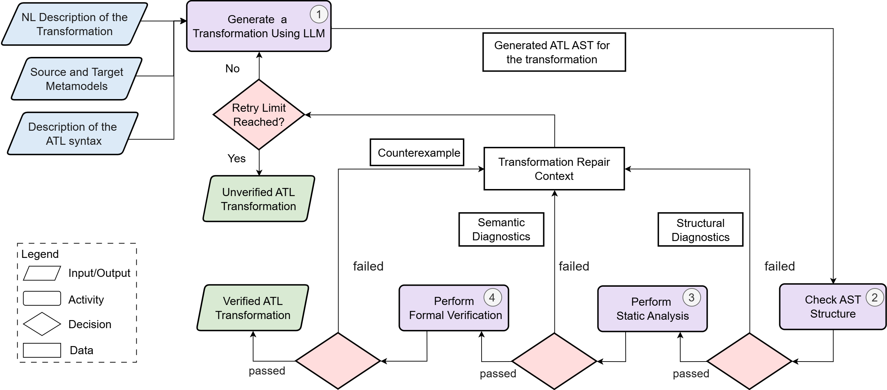

# Neuro-Symbolic LLM-Based Generation and Verification of ATL Transformations

This project presents a neuro-symbolic pipeline for generating ATL model transformations from metamodels and natural-language requirements, then progressively improving their correctness through structural checking, static analysis, and formal verification with violation-driven feedback.

The `LLM4ATL` branch contains the primary project code.

## Pipeline Overview



## Getting Started

### 1. Install the Python dependencies

From the repository root, open PowerShell and run:

```powershell
cd .\LLM4ATL_Project\Neuro_Symbolic_Pipeline
python -m pip install --upgrade pip
python -m pip install -r requirements.txt
```

### 2. Configure the API key

Create a local `.env` file from the provided template:

```powershell
Copy-Item .env.example .env
```

Open `.env`, select one provider, and add the corresponding API key. For example, to use Gemini:

```dotenv
LLM_PROVIDER=gemini
LLM_MODEL=gemini-3.6-flash
GEMINI_API_KEY=your_gemini_api_key_here
```

The other supported configurations are:

```dotenv
# OpenAI
LLM_PROVIDER=openai
LLM_MODEL=gpt-5.1
OPENAI_API_KEY=your_openai_api_key_here

# Anthropic Claude
LLM_PROVIDER=claude
LLM_MODEL=claude-sonnet-4-5
ANTHROPIC_API_KEY=your_anthropic_api_key_here
```

Only the key for the selected provider is required. Keep `.env` private and never commit a real API key to the repository.

### 3. Configure the validation layers

Set the layer switches in `.env`. If a variable is omitted, its default value is `true`.

| Variable | Layer controlled |
| --- | --- |
| `ABLATION_ENABLE_LAYER1_SCHEMA` | Layer 1: structural/schema validation of the generated ATL AST |
| `ABLATION_ENABLE_LAYER2_SEMANTIC` | Layer 2: semantic and static analysis, including all Layer 2 subchecks |
| `ABLATION_ENABLE_LAYER3_GENERATION` | Layer 3: formal counterexample checking with ATL2TM/eFinder |

Use all three layers for a normal pipeline run:

```dotenv
ABLATION_ENABLE_LAYER1_SCHEMA=true
ABLATION_ENABLE_LAYER2_SEMANTIC=true
ABLATION_ENABLE_LAYER3_GENERATION=true
```

For an ablation run, set the layer being evaluated to `false` and give the run a unique label. For example:

```dotenv
# Run without Layer 1
ABLATION_ENABLE_LAYER1_SCHEMA=false
ABLATION_ENABLE_LAYER2_SEMANTIC=true
ABLATION_ENABLE_LAYER3_GENERATION=true
ABLATION_RUN_LABEL=without_l1
```

Equivalent labels and switches for the other individual-layer configurations are:

```dotenv
# Run without Layer 2
ABLATION_ENABLE_LAYER1_SCHEMA=true
ABLATION_ENABLE_LAYER2_SEMANTIC=false
ABLATION_ENABLE_LAYER3_GENERATION=true
ABLATION_RUN_LABEL=without_l2

# Run without Layer 3
ABLATION_ENABLE_LAYER1_SCHEMA=true
ABLATION_ENABLE_LAYER2_SEMANTIC=true
ABLATION_ENABLE_LAYER3_GENERATION=false
ABLATION_RUN_LABEL=without_l3
```

`ABLATION_RUN_LABEL` is required whenever any layer is disabled. Ablation artifacts are isolated under `output/ablation/<label>/`, preventing one configuration from overwriting or causing another run to be skipped. For a full run, remove `ABLATION_RUN_LABEL` or leave it empty.

When Layer 3 is disabled, the pipeline still converts the final AST into ATL, but it skips ATL2TM/eFinder verification. Layer 3 also reads `EFINDER_SCOPE`, `EFINDER_REFERENCE_SCOPE`, and `EFINDER_TIMEOUT_MS`. Increasing either scope may improve bounded-search coverage but can substantially increase solver time.

### 4. Run the main pipeline

While still inside `LLM4ATL_Project/Neuro_Symbolic_Pipeline`, run:

```powershell
python main.py
```

The pipeline processes the configured benchmark cases in sequence. For each case, it:

1. reads the natural-language requirement and its source and target Ecore metamodels;
2. asks the selected LLM to generate an ATL abstract syntax tree (AST);
3. applies structural checking and static analysis;
4. converts the validated AST into an ATL transformation;
5. runs formal verification and uses detected violations as feedback for another generation attempt.

Progress and validation errors are printed in the terminal. A candidate that passes all enabled layers is saved as the final result.

If an AST JSON file for a case already exists in the output directory, `main.py` skips that case. Rename or remove that specific JSON file before rerunning the pipeline when a fresh generation is required.

### 5. View the generated results

Generated files from a full run can be found at:

```text
LLM4ATL_Project/Neuro_Symbolic_Pipeline/output/
├── final_responses/
│   ├── atl_ast/              # Generated ATL AST files in JSON format
│   └── atl/                  # Generated ATL transformations
├── formal_verification/      # Layer 3 candidates, reports, and verification artifacts
└── metrics/                  # Per-task traces and the run summary
```

For example, the Families-to-Persons results are:

```text
output/final_responses/atl_ast/FamiliesToPersons_All.json
output/final_responses/atl/FamiliesToPersons_All.atl
```

## Validate the Generated ATL Transformations

Run the parser before the functional tests. The test runner uses the CSV report produced by the parser to decide which transformations can be executed.

### 1. Run ATL Parser

From `LLM4ATL_Project/Neuro_Symbolic_Pipeline`, move to `LLM4ATL_Project` and run:

```powershell
cd ..
python -m pip install fastchrf
python .\ATL_Parser\testATLParsedRate.py `
  --input-dir ".\Neuro_Symbolic_Pipeline\output\final_responses\atl" `
  --llm "gemini-3-6-flash" `
  --strategy "neuro_symbolic" `
  --tag "gemini-3-6-flash-neuro_symbolic_run"
```

The parser checks the generated ATL files and writes these reports to `LLM4ATL_Project/ATL_Parser/`:

```text
atl_parser_chrf_results_gemini-3-6-flash-neuro_symbolic_run.csv
atl_parsed_rate_gemini-3-6-flash-neuro_symbolic_run.csv
atl_chrf_similarity_gemini-3-6-flash-neuro_symbolic_run.csv
```

Report fields:

- `Parsed`: whether the transformation passes ATL syntax checking.
- `ProblemCount`: number of syntax problems found by the parser.
- `CHRF_Score`: textual similarity to the reference ATL; it does not measure functional correctness.

### 2. Run ATL Tests

After the parser finishes, continue with:

```powershell
python .\ATL_Tests\run_all_tests.py `
  --input-dir ".\Neuro_Symbolic_Pipeline\output\final_responses\atl" `
  --tag "gemini-3-6-flash-neuro_symbolic_run"
```

The runner executes the mapped JUnit test for each syntactically valid transformation and records its functional-test result.

The results are written to:

```text
LLM4ATL_Project/ATL_Tests/atl_test_results_gemini-3-6-flash-neuro_symbolic_run.csv
LLM4ATL_Project/ATL_Tests/atl_pass_rate_summary_gemini-3-6-flash-neuro_symbolic_run.csv
```

In `atl_test_results_*.csv`, `test_pass=True` means that the transformation was parsed successfully and passed its associated functional test.
